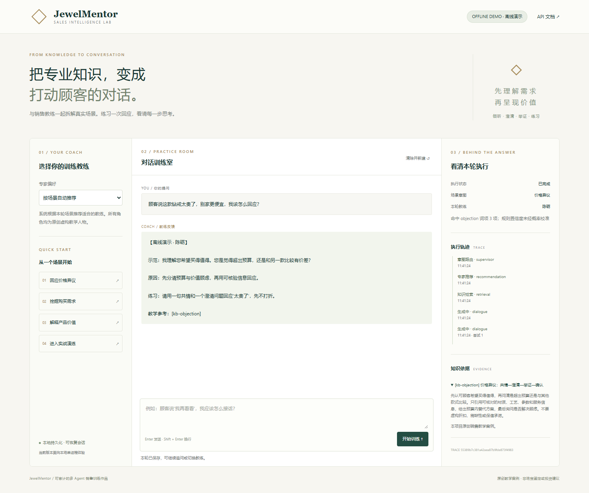
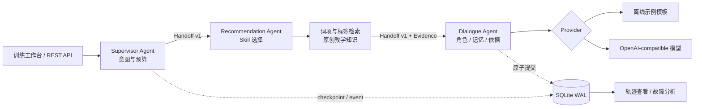
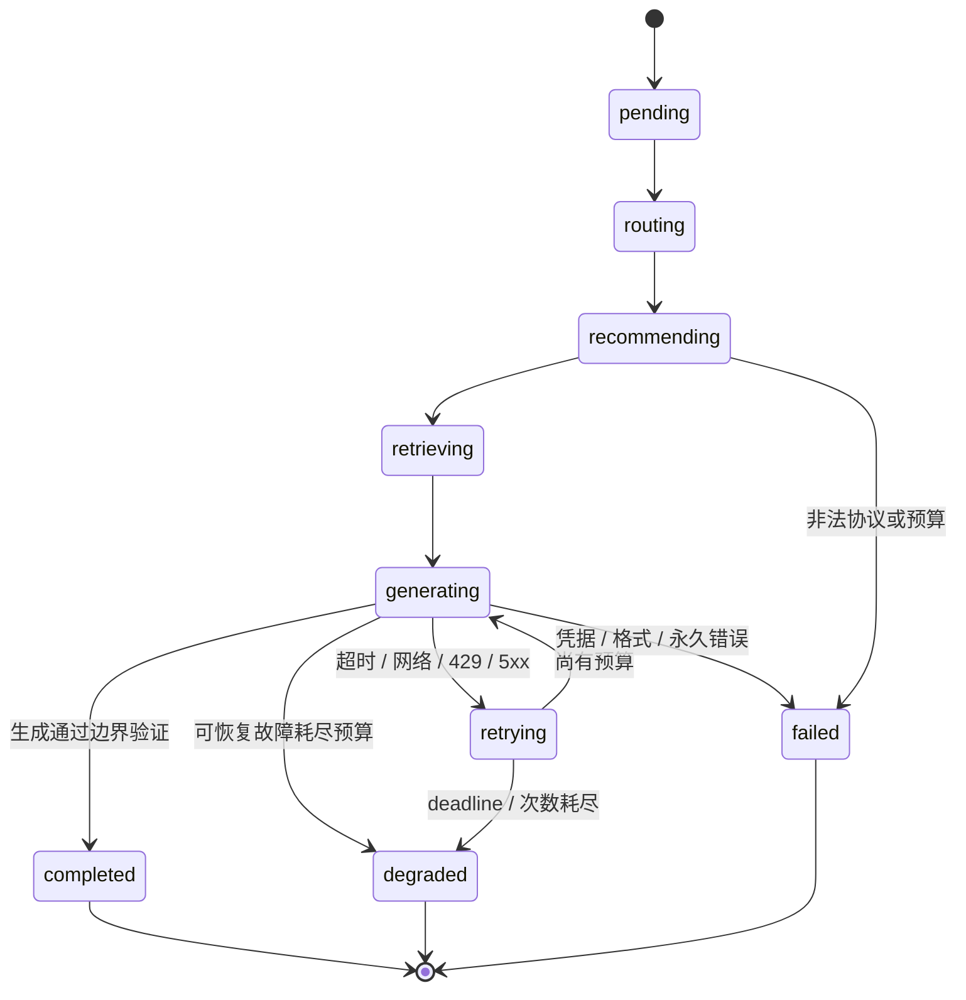

<div align="center">

# ◇ JewelMentor

**珠宝销售培训多 Agent 平台 · 从业务对话到可审计执行**

[](https://github.com/rryyyi/Agent-Project-1/actions/workflows/ci.yml)


[快速开始](#快速开始) · [架构与代码](#架构与代码) · [可靠性](#harness-可靠性设计) · [评测](#评测与真实口径) · [English](docs/README.en.md)

</div>

> 基于珠宝销售培训业务场景独立重建的个人工程作品。重点是 **Agent 控制流、规范交接、持久化恢复、模型边界和可复现评测**。本仓库不包含企业原始代码、客户数据或内部指标；人物与案例均为原创教学样例。



## 项目解决什么问题

新销售面对“太贵了”“我再看看”“4C 是什么”时，往往能背知识，却缺乏具体回应和练习。JewelMentor 把训练拆成“识别场景 → 选择教练 → 找到依据 → 示范与练习”，并让开发者看见每一步如何执行、失败和恢复。

一条典型输入：

```text
顾客说这款钻戒太贵了，别家更便宜，我该怎么回应？
```

执行结果：统领识别 `objection` → 推荐陈砺教练 → 检索 `kb-objection` → 生成示范、原因与练习 → 在 SQLite 中原子提交答复和终态。切换教练后保留公共对话；异常时有错误类别、有限重试和可追踪的回合记录。

**默认无需 API Key。** 离线模式使用明确标注的示例模板，跑通整条工程链路；实时模式通过 OpenAI-compatible API 调用模型。离线模板不具备开放域推理能力，不能用它的代理分证明真实模型教学效果。

## 已实现的工程能力

| 业务需求 | 代码中的实现 | 可核验证据 |
| --- | --- | --- |
| 不同场景选择不同教练 | Supervisor → Recommendation → Dialogue 三层角色；显式专家选择覆盖自动推荐 | `routing.py`、`catalog.py`、专家切换测试 |
| 上下文安全交接 | Pydantic `Handoff`，约束合法边、上下文长度、版本、证据、deadline 和 hop budget | `models.py`、协议拒绝测试 |
| 模型超时与失败可控 | 节点超时、整体 deadline、有限重试、错误分类、显式降级 | `harness.py`、故障注入测试 |
| 重启后继续执行 | SQLite WAL、事务、持久化 checkpoint、显式 resume API | 重启恢复与消息不重复测试 |
| 人格一致性 | 三份可校验的原创 Skill：成长轨迹、原则、风格、边界、Few-Shot | `data/experts.json` |
| 多轮记忆 | 有界历史窗口 + 仅包含训练字段的持久化记忆 | 上下文预算与专家切换测试 |
| 答复可追踪 | trace/session/turn ID、节点事件、尝试次数、耗时、错误类别 | 右侧轨迹面板与 `/traces` API |
| 评测能复现 | 版本化路由数据、故障场景、分母、混淆统计、失败归因 | [评测报告](docs/evaluation/demo-report.json) |

## 快速开始

需要 Python **3.11 或以上**、Git。推荐使用虚拟环境；不需要 Node 构建步骤或外部数据库。

```bash
git clone https://github.com/rryyyi/Agent-Project-1.git
cd Agent-Project-1
python -m venv .venv
```

激活环境：

```bash
# macOS / Linux
source .venv/bin/activate

# Windows PowerShell
.venv\Scripts\Activate.ps1

# Windows Git Bash
source .venv/Scripts/activate
```

安装并启动：

```bash
python -m pip install -e ".[dev]"
jewelmentor serve
```

打开 **http://127.0.0.1:8000**；交互 API 文档在 **http://127.0.0.1:8000/docs**。

PowerShell 不允许激活脚本时，可以直接运行：

```powershell
.venv\Scripts\python -m pip install -e ".[dev]"
.venv\Scripts\python -m jewelmentor.cli serve
```

建议体验顺序：

1. 点击“回应价格异议”，发送问题，观察教练、知识依据和执行轨迹。
2. 切换到林知微，继续询问如何确认预算；公共会话仍保留。
3. 刷新页面，确认对话和轨迹可重新加载。
4. 查看 `/docs`，使用同一个 `request_id` 重放，再修改消息观察 `409`。
5. 运行测试和评测，查看故障分母与降级案例。

## 接入真实模型

配置由**服务端环境变量**读取；不会把 API Key 发送到浏览器。`.env.example` 是变量说明，当前程序**不自动加载 `.env` 文件**。

```bash
# macOS / Linux / Git Bash
export JEWELMENTOR_PROVIDER=openai
export OPENAI_API_KEY="你的密钥"
export OPENAI_BASE_URL="https://api.openai.com/v1"
export OPENAI_MODEL="gpt-4o-mini"
jewelmentor serve
```

```powershell
# Windows PowerShell
$env:JEWELMENTOR_PROVIDER = "openai"
$env:OPENAI_API_KEY = "你的密钥"
$env:OPENAI_BASE_URL = "https://api.openai.com/v1"
$env:OPENAI_MODEL = "gpt-4o-mini"
jewelmentor serve
```

兼容模型服务需要实现 `POST /chat/completions`，返回 `choices[0].message.content`，并支持 `temperature` 和 `max_tokens`。具体模型名称以服务商为准。远程地址要求 HTTPS，本机开发允许 localhost HTTP。实时模式配置错误会拒绝启动；调用失败会报告失败或降级，不静默切成离线答案。项目未附带、未消耗任何真实模型密钥；真实模型质量需另做评估。

| 变量 | 默认值 | 含义 |
| --- | --- | --- |
| `JEWELMENTOR_PROVIDER` | `demo` | `demo` 或 `openai` |
| `JEWELMENTOR_DB` | `runtime/jewelmentor.db` | SQLite 路径，父目录自动创建 |
| `OPENAI_API_KEY` | 空 | 实时模式必填 |
| `OPENAI_BASE_URL` | `https://api.openai.com/v1` | 服务端控制的模型地址 |
| `OPENAI_MODEL` | `gpt-4o-mini` | 模型标识 |
| `JEWELMENTOR_NODE_TIMEOUT` | `20` | 单次生成超时，秒 |
| `JEWELMENTOR_TURN_TIMEOUT` | `60` | 回合总时间预算，秒 |

默认最多生成两次、两个合法 Agent 交接；代码中的 hop 上限为 4，给后续编排保留显式预算。更多配置见 [运行说明](docs/operations.md)。

## 架构与代码



这里的 Agent 是职责明确、可独立检查的协作单元，**不是三个必须各调用一次模型的聊天机器人**。统领和推荐使用确定性策略，以降低延迟并便于测试；对话生成通过 Provider 替换。相比把所有逻辑藏进一个大 Prompt，显式边界便于检验；相比多服务部署，模块化单体便于本地复现。完整取舍见 [架构说明](docs/architecture.md)。

```text
src/jewelmentor/
├── api.py             HTTP 边界、错误结构、静态页面
├── models.py          状态、交接、请求、上下文、结果协议
├── routing.py         有弃权能力的词项路由基线
├── catalog.py         Skill 选择、知识检索
├── harness.py         状态推进、预算、生成、恢复
├── store.py           事务、checkpoint、消息与事件
├── providers.py       提示组装、离线与真实模型适配
├── config.py          环境配置与密钥边界
├── evaluation.py      数据版本、分母、场景与代理评分
├── cli.py             serve / evaluate
├── data/              原创专家、知识与评测数据
└── static/            无构建依赖的中文训练工作台
tests/                 业务、故障、恢复、Provider、API、评测测试
docs/                  架构、运行、评测、英文概览
.github/               CI、依赖更新与协作模板
```

## Harness 可靠性设计



- **先落检查点再调用模型**：历史消息与回合创建在同一事务；进入生成前保存角色、依据和有界上下文。
- **终态原子提交**：助手消息、回合结果、训练记忆和终态事件在同一事务内提交。
- **幂等**：`(session_id, request_id)` 唯一；相同 payload 返回已存结果，不同 payload 返回 `409`。
- **有限重试**：仅临时网络、限流、服务端故障、超时可重试；鉴权、参数或响应格式错误直接失败。
- **中断恢复**：显式 resume 延续已完成的路由/检索，重新获取本轮时间预算，但保留 hop 和尝试次数。恢复不了的耗尽回合会显式降级。
- **同会话串行**：每个会话共享锁，发送与删除使用同一把锁；不同会话可以并发等待模型。
- **事件可审计**：记录节点、状态、attempt、错误类别及部分重试耗时；不在事件里复制原始异常或服务商响应正文。

恢复语义是 **上游模型调用至少一次、本地答复提交一次**。如果进程在模型已返回但本地事务尚未提交时崩溃，恢复可能重复计费；当前没有上游幂等保证。SQLite 和进程内锁只适合当前单机单进程版本，不能用 `--workers 4` 扩容。更多细节见 [恢复与故障边界](docs/reliability.md)。

## Persona Skill、记忆与知识

三个原创虚构角色分别擅长需求探索、异议处理和客户关系。Skill 数据包含成长阶段、职业教训、原则、语言风格、边界与示范对话，并带有版本号。它是可校验的领域角色包，不是对真实名人生平的未经核实重构。

短期上下文最多 12 条、合计 18,000 字符；长期记忆仅保存训练目标、上次意图、上次专家和完成次数。原始用户文本不会自动变成系统指令或长期画像。浏览器仅保存会话 ID，服务端数据库保存对话；“清除并新建”会级联删除会话相关消息、记忆、回合和事件。

当前知识集只有 5 条原创教学记录，使用可解释的词项/标签评分，不包含向量数据库、Reranker 或 Graph RAG。返回的 `evidence` 表示检索候选，模型是否正确使用它仍需人工核验；系统提示要求引用合法 ID，但尚无完整语义事实校验器。

## API 示例

```bash
# 创建会话，复制响应中的 id
curl -X POST http://127.0.0.1:8000/api/sessions

# 替换 SESSION_ID；PowerShell 建议用 curl.exe
curl -X POST http://127.0.0.1:8000/api/sessions/SESSION_ID/messages \
  -H "Content-Type: application/json" \
  -d '{"message":"顾客觉得钻戒太贵了","request_id":"demo-001","expert_id":"chen"}'
```

响应关键字段：

```json
{
  "session_id": "…",
  "turn_id": "…",
  "trace_id": "…",
  "state": "completed",
  "answer": "【离线演示 · 陈砺】\n\n示范：…",
  "expert_id": "chen",
  "route": {"intent": "objection", "confidence": 0.72, "reason": "命中词项…"},
  "evidence": [{"id": "kb-objection", "title": "价格异议：共情—澄清—举证—确认", "content": "…", "tags": ["objection"], "source": "本项目原创销售教学案例。"}],
  "provider": "demo",
  "error_category": null
}
```

这是字段结构示意，ID 与文案以实际运行结果为准。`confidence` 是启发式评分，不是经过统计校准的概率。

| 方法 | 路径 | 用途 |
| --- | --- | --- |
| GET | `/health` | 版本、模式和部署边界 |
| GET | `/api/experts` | 可用角色 Skill |
| POST | `/api/sessions` | 创建会话，返回 201 |
| GET / DELETE | `/api/sessions/{sid}` | 读取 / 删除会话 |
| POST | `/api/sessions/{sid}/messages` | 提交回合 |
| GET | `/api/sessions/{sid}/traces` | 查询执行事件 |
| POST | `/api/sessions/{sid}/turns/{tid}/resume` | 恢复中断回合；终态可幂等重放 |
| GET | `/api/knowledge/{id}` | 查询知识依据 |

业务结果包括 `completed`、`degraded`、`failed`，均通过结构化结果返回。不存在的资源返回 404，幂等冲突或未恢复回合返回 409，输入不合法返回 422。错误统一为 `{"error":{"code":"…","message":"…"}}`。

## 评测与真实口径

```bash
jewelmentor evaluate --output runtime/evaluation.json
```

完整报告：[demo-report.json](docs/evaluation/demo-report.json)，解释：[评测方法](docs/evaluation.md)。当前评测由 30 条人工编写的路由开发样本和 10 个编排场景组成，其中 4 个是故意注入的故障。

| 指标 | 离线开发集结果 | 应怎样理解 |
| --- | --- | --- |
| 路由准确率 | 30 / 30 | 词项开发样本的回归表现；不是独立留出集泛化能力 |
| 正常完成 / 全部尝试 | 6 / 10 | 4 个故意故障保留在分母中，降级不算成功 |
| 场景契约通过率 | 10 / 10 | 正常任务完成，故障返回预期终态和错误类别 |
| 教学结构代理分 | 1.0，6 个完成样本 | 只检查示范、原因、练习的结构覆盖 |
| 角色边界代理分 | 1.0，6 个完成样本 | 离线标识与少量禁止短语检查；不是人类还原度 |

这些规则和样本共同开发，样本很小；分数高说明回归契约匹配，不能说明在线业务已达到同等效果。报告附数据版本、SHA-256、时间、环境、逐例输出与失败归因。真实销售教学效果需要前后测、盲评和独立留出集。

简历中的 **94% 意图识别、96% 交接成功、98.2% 用户还原度** 不作为本仓库实测成绩，也不通过调整评测数据去凑对应数字。本仓库可以独立证明的是实现、测试、故障行为与运行结果。

## 测试与开发

```bash
python -m pytest -q
ruff check .
ruff format --check .
python -m build

# 可选：真实浏览器冒烟检查（默认测试无需 Playwright）
python -m pip install -e ".[browser]"
playwright install chromium
python scripts/browser_smoke.py
```

测试使用临时 SQLite 和模拟 HTTP 传输，不调用真实模型。覆盖合法/非法状态、协议预算、路由弃权、知识命中、超时和重试、鉴权失败、响应格式、恢复、并发隔离、幂等冲突、删除和 API 校验。GitHub Actions 在 Python 3.11、3.12、3.13 上执行测试、静态检查、构建与离线评测，并设有独立浏览器和容器冒烟任务。

代码按领域边界拆分，通过类型和依赖注入维持接口清晰；仓库保留设计与实现计划，方便理解关键取舍。贡献流程见 [CONTRIBUTING.md](CONTRIBUTING.md)，安全问题见 [SECURITY.md](SECURITY.md)，版本变化见 [CHANGELOG.md](CHANGELOG.md)。

## Docker

```bash
docker build -t jewelmentor:0.1.0 .
docker run --rm -p 127.0.0.1:8000:8000 -v jewelmentor-data:/app/runtime jewelmentor:0.1.0
```

容器内监听 `0.0.0.0`，宿主映射仍绑定 localhost。镜像使用非 root 用户；命名卷保存对话。Docker 命令需本机已安装 Docker，测试证据会在 [验证记录](docs/verification.md) 中明确区分实际执行和未执行部分。

## 当前边界与演进

本地演示版本没有登录、租户权限、速率限制、分布式锁或公开部署保护；默认只监听 localhost。把它部署为公网服务前，应先实现身份认证、资源授权、输入体限制、隐私保留策略和运维监控。

优先演进顺序：

1. 独立留出集、模糊意图与真实训练反馈；对路由置信度做校准。
2. 真实模型的语义引用校验、人格一致性盲评与对抗测试。
3. PostgreSQL、持久化任务队列、租约与 fencing token，支撑多进程执行。
4. 在更大的授权语料上评估混合检索和 Rerank 的收益。
5. 身份认证、多租户授权、数据保留和生产可观测性。

## 许可证与资料来源

代码、虚构角色和原创教学样例采用 [MIT License](LICENSE)。知识条目用于演示工程流程，不替代珠宝鉴定、商家真实售后政策或专业建议。项目由 [rryyyi](https://github.com/rryyyi) 维护。
