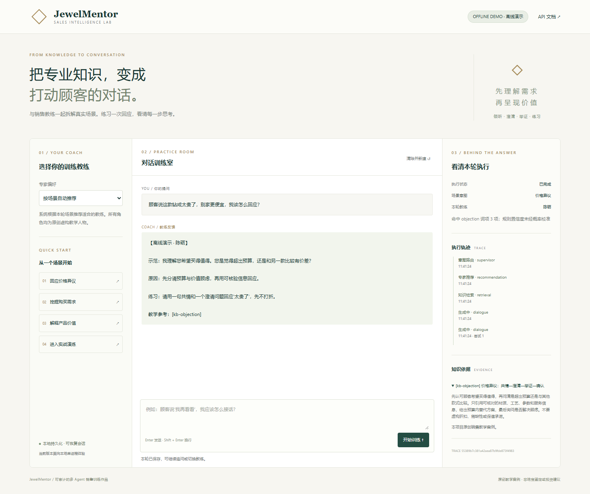

# JewelMentor

An inspectable multi-agent training workbench for jewelry sales, built as an independently reconstructed engineering portfolio. The repository contains original fictional personas and teaching examples, not an employer's proprietary code or production metrics.



## Run locally

Requires Python >=3.11. No API key or external database is needed for the default offline demonstration.

```bash
git clone https://github.com/rryyyi/Agent-Project-1.git
cd Agent-Project-1
python -m venv .venv
# Activate .venv using your shell's standard activation command.
python -m pip install -e '.[dev]'
jewelmentor serve
```

Open http://127.0.0.1:8000. REST documentation is at `/docs`. The Chinese workbench supports scenario selection, expert switching, durable conversations, evidence inspection, traces and explicit interrupted-turn recovery.

## Architecture

A Supervisor owns routing, budgets and the durable state machine. A Recommendation Agent selects a validated persona Skill. A Dialogue Agent uses bounded conversation context and retrieved evidence through an injected Provider. Supervisor and recommendation are deterministic policies, not extra LLM calls.

SQLite stores sessions, messages, turns, events and checkpoints. Handoff contracts validate authorized edges and context budgets. The harness enforces per-attempt and overall deadlines, bounded retries and explicit degraded/failed outcomes. An idempotency key prevents duplicate local commits; payload collisions return 409. Recovery resumes persisted context without duplicating the user message.

The guarantee is at-least-once upstream generation and one locally committed response under the documented single-process model. It does not guarantee exactly-once model billing or distributed coordination.

## Live models

Set server-side `JEWELMENTOR_PROVIDER=openai`, `OPENAI_API_KEY`, optional `OPENAI_BASE_URL` and `OPENAI_MODEL`, then restart. The adapter uses `/chat/completions`, `temperature` and `max_tokens`. Remote URLs require HTTPS; localhost HTTP is accepted for development. `.env` files are not automatically loaded.

DemoProvider is an explicitly labeled template baseline. Live errors do not silently become demo success. No real-model evaluation has been performed without a configured provider and key.

## Verification

```bash
python -m pytest -q
ruff check .
ruff format --check .
jewelmentor evaluate --output runtime/evaluation.json
python -m build
```

The versioned synthetic development set has 30 routing fixtures and 10 orchestration scenarios. The baseline is 30/30 routing regression, 6/10 completed tasks including four intentional failures, and 10/10 expected scenario contracts. Role/learning checks are narrow template proxies, not human ratings or measured learning gains. See [methodology](evaluation.md) and [report](evaluation/demo-report.json).

## Scope and trade-offs

- Three original fictional Skills, five teaching records and transparent lexical retrieval.
- One process, local SQLite, no authentication or tenant authorization.
- Server-side keys, sanitized error events and browser rendering through textContent.
- No vector database, distributed queue, semantic citation validator or production SLO claim.
- CI for Python 3.11–3.13; package data includes the UI and versioned corpus.

Read the detailed [Chinese README](../README.md), [architecture](architecture.md), [reliability contract](reliability.md), [operations](operations.md) and [verification record](verification.md). Contributions follow [CONTRIBUTING](../CONTRIBUTING.md). Original code and teaching assets are MIT licensed.
